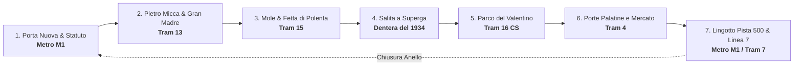

<div align="center">

# 🚋 Torino su Rotaia
### *Il giro panoramico di Torino solo in tram, metro e cremagliera*

[](https://github.com/MRJonam91/TorinoTramTour/stargazers)
[](LICENSE.md)
[](https://github.com/MRJonam91/TorinoTramTour)
[](https://mrjonam91.github.io/TorinoTramTour/)
[](https://buymeacoffee.com/mrjonam91)
[](https://paypal.me/fbxmano)

<p align="center">
  <b>Innamorarsi di Torino guardando fuori dal finestrino.</b><br>
  Niente traffico e niente autobus: un anello continuo tra carrozze di legno del 1934, tram arancioni degli anni Cinquanta, villini Liberty, la Mole, i misteri del centro e la salita a cremagliera fino a Superga.
</p>

[**🌐 Apri la Mappa Interattiva**](https://mrjonam91.github.io/TorinoTramTour/) • [**📖 Leggi la Guida Completa**](tour_torino_su_rotaia.md) • [**☕ Offrici un bicerin**](#-ti-è-piaciuta-lidea-offrici-un-bicerin)

---

</div>

## 💡 Da dove nasce questa idea?

A Torino i binari del tram ci sono dal 1871. I viali sono larghi e alberati, le piazze hanno i portici più lunghi d'Europa, e la collina si specchia nel Po. Chi ci abita lo sa bene: attraversare la città in tram ha un fascino tutto suo, fatto di sferragliamenti familiari, scorci improvvisi e panche di legno lucido.

Abbiamo messo insieme le linee attuali di GTT per creare un **vero anello panoramico a cielo aperto**, usando solo mezzi su rotaia:
* 🚇 **100% su Rotaia:** Dalla metro senza conducente al tram 13, dal 15 alla salita a cremagliera di Superga, passando per il tram 16 immerso nel verde del Valentino e il 4 con le sue grandi vetrate.
* 🪟 **Il finestrino giusto:** In ogni tratta ti diciamo da che lato sederti per goderti il panorama migliore o per scattare una foto al volo.
* 🔮 **Le storie e le stranezze della città:** La *Fetta di Polenta* (una casa larga 54 cm in cui l'architetto andò ad abitare per scommessa), l'angelo del Frejus in Piazza Statuto che la leggenda chiama Lucifero, le palle di cannone del 1706 rimaste nei muri e il presunto nascondiglio del Graal.
* ⏱️ **Quanto tempo hai?** Un calcolatore semplice per farti il giro in 2 ore e mezza tutto a bordo, in mezza giornata con pausa caffè e foto, o con calma tutto il giorno visitando Superga e la pista della Fiat al Lingotto.
* 🗺️ **Mappa 100% libera e aperta:** Basata su **OpenStreetMap**, senza chiavi API o limitazioni.

---

## 🗺️ Le 7 Tappe del Giro



### 1. 🚇 Dai palazzi Liberty di Cit Turin a Piazza Statuto *(Metro M1)*
* **Tratta:** Porta Nuova ➔ Principi d'Acaja ➔ Piazza Statuto
* **Cosa provare:** Mettiti davanti al finestrone in testa alla prima carrozza: la metro non ha cabina di guida, quindi vedi i binari e la galleria che corrono dritto davanti a te.
* **Cosa notare:** Casa Fenoglio-Lafleur (una meraviglia Art Nouveau con ferri battuti floreali), la Casa dei Draghi e Piazza Statuto, la piazza esoterica di Torino con l'antico obelisco di pietra del 45° parallelo seminascosto nell'aiuola.

### 2. 👑 Tagliare il centro in diagonale fino al Po *(Tram 13)*
* **Tratta:** Piazza Statuto ➔ Via Pietro Micca ➔ Piazza Castello ➔ Gran Madre
* **Finestrino:** A sinistra su via Pietro Micca, poi da entrambi i lati lungo via Po.
* **Cosa notare:** Via Pietro Micca è l'unica via storta di tutta Torino che spezza l'antica scacchiera romana. Dal tram vedi Palazzo Madama e Palazzo Reale comparire all'improvviso, prima di scendere giù per via Po verso l'immensa Piazza Vittorio Veneto e la Gran Madre.

### 3. 📐 La Mole, la Fetta di Polenta e Corso Belgio *(Tram 15)*
* **Tratta:** Piazza Vittorio Veneto ➔ Corso San Maurizio ➔ Corso Belgio ➔ Sassi
* **Finestrino:** Lato sinistro su Corso San Maurizio.
* **Cosa notare:** A ogni incrocio di Vanchiglia la Mole Antonelliana compare tra i tetti, altissima. All'angolo con via Giulia di Barolo c'è la *Fetta di Polenta*, una casa gialla talmente stretta (54 cm sul fondo!) che nessuno voleva comprarla per paura crollasse. Poi il tram si infila nel lungo tunnel d'alberi di Corso Belgio fino ai piedi della collina.

### 4. ⛰️ La Dentera del 1934: salita nel bosco a Superga *(Tranvia a Cremagliera)*
* **Tratta:** Stazione Sassi (Piazza Modena) ➔ Basilica di Superga
* **Cosa provare:** Si viaggia sulle carrozze storiche del 1934 con panche in legno e ruota dentata centrale, arrampicandosi nel bosco con una pendenza ripida che tocca il 21% (d'estate ci sono anche i vagoni aperti!).
* **In cima:** La Basilica di Juvarra, le Tombe dei Reali sabaudi, la lapide del Grande Torino e un balcone sulle Alpi che lascia senza fiato.

### 5. 🌳 Il tram nel verde lungo il Parco del Valentino *(Tram 16 CS)*
* **Tratta:** Piazza Vittorio Veneto ➔ Corso Cairoli ➔ Corso Massimo d'Azeglio
* **Cosa provare:** Il 16 è la storica circolare dei torinesi. Lungo Corso Massimo d'Azeglio i binari corrono in mezzo al prato e all'ombra dei platani del Parco del Valentino, tra le torri del Borgo Medievale e i villini Liberty di San Salvario.

### 6. 🏛️ La spina centrale: mercati e torri romane *(Tram 4)*
* **Tratta:** Corso Sommeiller ➔ Porta Nuova ➔ Via XX Settembre ➔ Porta Palazzo
* **Cosa provare:** Grandi vetrate panoramiche da terra a soffitto per guardare la città.
* **Cosa notare:** Porta Palazzo (il mercato all'aperto più grande d'Europa, vivo e coloratissimo) e le Porte Palatine del I secolo a.C. con le loro torri romane in mattoni rossi.

### 7. 🏎️ La pista sul tetto della Fiat e il tram storico *(Metro M1 / Tram 7)*
* **Tratta:** Lingotto (Metro M1) + Anello centro (Linea 7)
* **Cosa notare:** Al Lingotto prendi l'ascensore e sali sul tetto dell'ex fabbrica Fiat per camminare sulla leggendaria pista parabolica di collaudo (quella di *The Italian Job*!), oggi diventata un giardino pensile panoramico con la Pinacoteca Agnelli.
* **Nel fine settimana:** Chiudi la giornata salendo sulla **Linea 7**: una carrozza vera degli anni Trenta restaurata dall'ATTS, che gira per il centro al prezzo di un semplice biglietto del tram.

---

## ⏱️ Quanto tempo serve?

| Giro | Tempo totale stimato | Come è organizzato |
| :--- | :---: | :--- |
| ⚡ **Veloce** | **~2h 30m** | Tutto a bordo, pause minime per cambiare mezzo: puro piacere del finestrino |
| 🌟 **Il Consigliato** | **~4h 45m** | Il ritmo giusto: tempo per un caffè storico, foto a Superga e due passi nel parco |
| 🏰 **Con Calma** | **~7h 30m** | Giornata piena: salita sulla cupola di Superga, Pista 500 al Lingotto e pranzo tipico |

Puoi scegliere il tuo orario di partenza nella pagina web [index.html](index.html) e personalizzare i minuti di sosta per ogni singola tappa: gli orari di arrivo e ripartenza si aggiornano da soli.

---

## 💻 Come provarlo sul computer

Non serve installare nulla: è una pagina web pulita e leggera.

```bash
# Scarica la cartella
git clone https://github.com/MRJonam91/TorinoTramTour.git
cd TorinoTramTour

# Aprila con il tuo browser preferito (Chrome, Firefox, Edge, Safari...)
# Su Windows basta un doppio clic su index.html, oppure da terminale:
Start-Process index.html
```

---

## ☕ Ti è piaciuta l'idea? Offrici un bicerin!

Questo progetto è nato per passione, in modo del tutto indipendente, per far scoprire una Torino autentica, a misura d'uomo e rispettosa dell'ambiente. Se ti è tornato utile o ti ha fatto venire voglia di fare un giro in tram:

* ☕ **[Offrici un caffè su Buy Me a Coffee](https://buymeacoffee.com/mrjonam91)**
* 💳 **[Fai una piccola donazione libera su PayPal](https://paypal.me/fbxmano)**
* ⭐ **Metti una stella al progetto qui su GitHub:** Aiuta a farlo scoprire ad altri viaggiatori!

---

## 📄 Licenza & Tutela dell'Idea

Questo progetto è distribuito sotto licenza **[Creative Commons Attribuzione - Non commerciale - Non opere derivate 4.0 Internazionale (CC BY-NC-ND 4.0)](LICENSE.md)**.

* ✅ **Per le persone:** Usalo liberamente per girare Torino, con amici, in famiglia, per studio o per divertimento.
* ❌ **Per scopi commerciali:** Non è consentito rivendere questo format, usarlo per tour commerciali a pagamento o crearne copie derivate a scopo di lucro senza accordo scritto con l'autore.

**Autore:** [Manoj Rollo (@MRJonam91)](https://github.com/MRJonam91) — Email: `fbxmano@gmail.com`

---

<div align="center">
  <b>⭐ Se ti piace Torino vista dai finestrini del tram, lascia una stella in alto a destra! ⭐</b>
</div>
