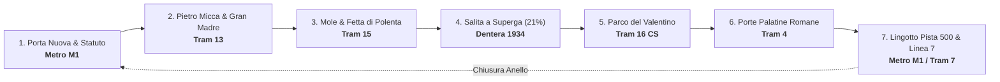

<div align="center">

# 🚋 Torino Tram Tour
### *Il Gran Tour Panoramico su Rotaia della Capitale Sabauda*

[](https://github.com/MRJonam91/TorinoTramTour/stargazers)
[](LICENSE.md)
[](https://github.com/MRJonam91/TorinoTramTour)
[](https://mrjonam91.github.io/TorinoTramTour/)
[](https://buymeacoffee.com/mrjonam91)
[](https://paypal.me/fbxmano)

<p align="center">
  <b>Esplora tutta Torino senza mai salire su un autobus o prendere l'auto!</b><br>
  Un circuito panoramico continuo su rotaia tra carrozze storiche del 1934, tram d'epoca, Liberty, misteri della magia nera e bianca, la Mole Antonelliana e la spettacolare cremagliera di Superga.
</p>

[**🌐 Prova la Mappa Interattiva Live**](https://mrjonam91.github.io/TorinoTramTour/) • [**📖 Guida Testuale Completa**](tour_torino_su_rotaia.md) • [**💖 Sostieni il Progetto**](#-sostieni-il-progetto)

---

</div>

## 🌟 Perché Questo Progetto è Unico?

Torino possiede la **rete tranviaria più antica d'Italia** (inaugurata nel 1871) e una conformazione urbanistica straordinaria, fatta di grandi corsi alberati, portici monumentali ininterrotti, ponti ottocenteschi sul Po e una collina che supera i 670 metri.

**Torino Tram Tour** trasforma il trasporto pubblico su ferro (GTT) in un vero e proprio **treno panoramico urbano ad alta sostenibilità**:
* 🚇 **100% su Rotaia:** Metro M1 (VAL automatico su gomma), Tram 13, Tram 15, Tranvia a Dentiera Sassi-Superga, Tram 16 dei Grandi Viali, Tram 4 e Linea 7 Storica.
* 🪟 **Consigli Finestrino Panoramico:** Indicazione esatta del lato della vettura da cui guardare per inquadrare monumenti e scorci fotografici.
* 🔮 **Curiosità & Misteri:** Dalla *Fetta di Polenta* (il palazzo più stretto del mondo, largo appena 54 cm) all'Angelo di Piazza Statuto (vertice della Magia Nera), dalle palle di cannone del 1706 murate nelle facciate al Santo Graal della Gran Madre.
* ⏱️ **Personalizzazione Dinamica dei Tempi:** Generatore istantaneo di cronoprogramma per tour *Express* (2h30), *Classico* (4h45) o *Slow Full Day* (7h30) con orari esatti di passaggio calcolati per ogni fermata.

---

## 🗺️ Il Percorso: L'Anello delle 7 Tappe



### 1. 🚇 Dal Futuro al Liberty & Torino Esoterica *(Metro M1)*
* **Tratta:** Porta Nuova ➔ Principi d'Acaja ➔ Piazza Statuto
* **Esperienza:** Salire in testa al primo treno automatico VAL senza conducente d'Italia per osservare il tunnel dal parabrezza frontale.
* **Cosa vedere:** Casa Fenoglio-Lafleur (capolavoro Art Nouveau 1902), la Casa dei Draghi, Piazza Statuto, il Monumento al Frejus e l'Obelisco Geodetico del 45° parallelo.

### 2. 👑 La Diagonale Ottocentesca e il Cuore Reale *(Tram 13)*
* **Tratta:** Piazza Statuto ➔ Via Pietro Micca ➔ Piazza Castello ➔ Gran Madre
* **Finestrino:** Lato sinistro fino a Piazza Castello, poi entrambi lungo Via Po.
* **Cosa vedere:** La diagonale di Via Pietro Micca, Palazzo Madama, Palazzo Reale, Real Chiesa di San Lorenzo, i portici continui di Via Po, Piazza Vittorio Veneto e la Chiesa della Gran Madre di Dio (leggenda del Sacro Graal).

### 3. 📐 Mole Antonelliana, Fetta di Polenta e Corso Belgio *(Tram 15)*
* **Tratta:** Piazza Vittorio Veneto ➔ Corso San Maurizio ➔ Corso Belgio ➔ Sassi
* **Finestrino:** Lato sinistro (vista Mole).
* **Cosa vedere:** Scorci ravvicinati sulla Mole Antonelliana, la celeberrima **"Fetta di Polenta"** (Casa Scaccabarozzi, larga solo 54 cm!), il Campus Luigi Einaudi di Norman Foster e il tunnel di platani secolari di Corso Belgio.

### 4. ⛰️ La "Dentera" del 1934: Arrampicata a Superga *(Tranvia a Cremagliera)*
* **Tratta:** Stazione Sassi (Piazza Modena) ➔ Basilica di Superga (672 m s.l.m.)
* **Esperienza:** Salita di 3,1 km nei boschi con pendenze al **21%** sulle vetture storiche in legno del **1934** o sui vagoni aperti "a giardiniera".
* **Cosa vedere:** Il Museo Storico a Sassi (funicolare Agudio 1884), la Basilica barocca di Juvarra, le Tombe Reali Sabaude, la lapide del Grande Torino e il balcone panoramico sulle Alpi dal Monviso al Monte Rosa.

### 5. 🌳 Il "Treno Verde" lungo il Parco del Valentino *(Tram 16 CS)*
* **Tratta:** Piazza Vittorio Veneto ➔ Corso Cairoli ➔ Corso Massimo d'Azeglio
* **Esperienza:** La storica "Linea dei Viali" corre in sede propria erbosa immersa tra gli alberi del Parco del Valentino sulle gloriose motrici *Serie 2800 "Due Camere e Cucina"*.
* **Cosa vedere:** Murazzi del Po, Castello del Valentino (UNESCO), Borgo Medievale, Torino Esposizioni (volte di Pier Luigi Nervi) e il Museo della Frutta Garnier Valletti.

### 6. 🏛️ La Spina Reale, Porta Palazzo e le Porte Romane *(Tram 4)*
* **Tratta:** Corso Sommeiller ➔ Porta Nuova ➔ Via XX Settembre ➔ Porta Palazzo
* **Esperienza:** Grandi vetrate panoramiche da terra a soffitto dei tram Cityway e Hitachi Rail.
* **Cosa vedere:** Sinagoga Moresca, Piazza San Carlo, Duomo della Sindone, Porta Palazzo (il mercato all'aperto più grande d'Europa) e le Porte Palatine del I sec. a.C. con torri poligonali romane.

### 7. 🏎️ Gran Finale: Pista 500 al Lingotto & Tram Storico 7 *(Metro M1 / Tram 7)*
* **Tratta:** Lingotto (Metro M1) + Anello Centro Storico (Linea 7)
* **Cosa vedere:** L'ex fabbrica Fiat del 1923, la **Pista 500** sopraelevata sul tetto con le curve paraboliche trasformata da Renzo Piano nel giardino pensile artistico più alto d'Europa, la Pinacoteca Agnelli e il Grattacielo della Regione (205 m).
* **Weekend Bonus:** Nel fine settimana, giro sui tram d'epoca restaurati della **Linea 7 Storica** dell'ATTS con normale biglietto urbano.

---

## ⏱️ Personalizzazione Tempi: Tre Ritmi di Viaggio

| Modalità | Tempo Totale | Tempo a Bordo | Sosta a Terra | Ideale Per |
| :--- | :---: | :---: | :---: | :--- |
| ⚡ **Express Panoramico** | **~2h 30m** | 2h 13m | ~20m totali | Chi vuole godersi la vista dal finestrino in movimento |
| 🌟 **Classico Consigliato** | **~4h 45m** | 2h 13m | ~2h 30m | Il giro perfetto con foto, caffè a Piazza Castello e Superga |
| 🏰 **Slow / Full Day** | **~7h 30m** | 2h 13m | ~5h 15m | Visita a musei, Tombe Reali, Pista 500 e Tram Storico 7 |

Nell'app interattiva [index.html](index.html) puoi regolare al minuto il tempo di sosta per ciascuna tappa e impostare il tuo orario di partenza esatto per generare la tabella di marcia personalizzata.

---

## 📋 Inventario Completo dei Mezzi su Rotaia a Torino

* 🚇 **Metropolitana M1 (e futura M2):** 23 stazioni da Fermi a Bengasi, sistema VAL 208 su gomma.
* 🚊 **8 Linee Tranviarie Ordinarie GTT:** Tram 3, 4, 9, 10, 13, 15, 16 CD e 16 CS.
* ⛰️ **Tranvia a Cremagliera Sassi–Superga ("La Dentera"):** 3,1 km, cremagliera Strub del 1934, pendenza 21%.
* 🏛️ **Linea 7 Storica:** Museo viaggiante con vetture restaurate dagli anni '30 agli anni '50.
* 🍷 **Tram Ristorante Ristocolor & Gustotram:** Cene gourmet a lume di candela su tram d'epoca.
* 🚆 **SFM & Passante Ferroviario Sotterraneo:** 8 linee suburbane e la ferrovia storica Torino-Ceres per l'Aeroporto.

---

## 💻 Come Avviare l'Applicazione in Locale

Il progetto è sviluppato in architettura **Zero-Config, Single-File Web App**:

```bash
# 1. Clona la repository
git clone https://github.com/MRJonam91/TorinoTramTour.git

# 2. Entra nella cartella
cd TorinoTramTour

# 3. Apri direttamente index.html con qualsiasi browser
# Su Windows (PowerShell):
Start-Process index.html

# Oppure avvia un piccolo server locale (opzionale):
python -m http.server 8000
```

---

## 💖 Sostieni il Progetto

Se hai trovato utile questa guida, se hai scoperto angoli segreti di Torino o se ami il trasporto sostenibile su rotaia, puoi supportare lo sviluppo indipendente di questo progetto:

* ☕ **[Offrimi un Caffè su Buy Me a Coffee](https://buymeacoffee.com/mrjonam91)**
* 💳 **[Donazione libera via PayPal](https://paypal.me/fbxmano)**
* ⭐ **Lascia una Stella su GitHub:** Aiuta il progetto a farsi conoscere nel mondo!

---

## 📄 Licenza a Tutela dell'Idea e Proprietà Intellettuale

Questo progetto è distribuito sotto licenza **[Creative Commons Attribuzione - Non commerciale - Non opere derivate 4.0 Internazionale (CC BY-NC-ND 4.0)](LICENSE.md)**.

* ✅ **Uso personale, didattico, turistico e divulgativo:** Libero e gratuito per tutti i viaggiatori e appassionati.
* ❌ **Uso commerciale o derivato non autorizzato:** È severamente vietata la rivendita, lo sfruttamento commerciale per tour a pagamento e la creazione di opere derivate senza espressa autorizzazione scritta dell'autore.

**Autore:** [Manoj Rollo (@MRJonam91)](https://github.com/MRJonam91) — Contatto: `fbxmano@gmail.com`

---

<div align="center">
  <b>⭐ Se ti piace Torino e il mondo dei tram, lascia una stella in alto a destra! ⭐</b>
</div>
